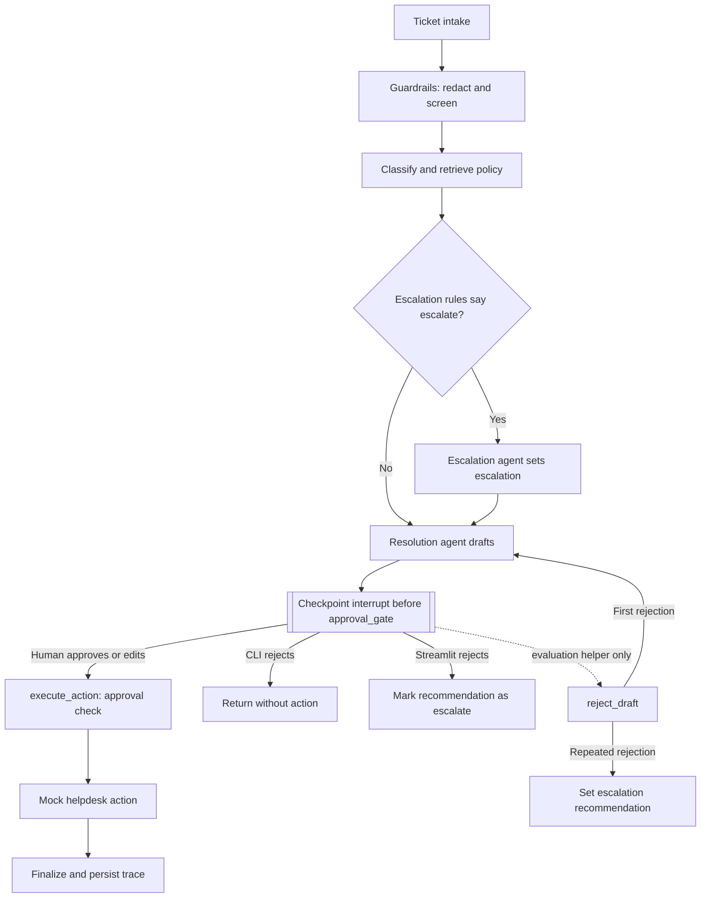

# AG-02 Customer Support Ticket Triage

A local, deterministic support-ticket triage demo with policy lookup, reviewable drafts, and a human approval check before its mock helpdesk action.

## Contents

- [What this project is](#what-this-project-is)
- [Quick start](#quick-start)
- [How it works](#how-it-works)
- [Worked example](#worked-example)
- [Project structure](#project-structure)
- [Data](#data)
- [Configuration](#configuration)
- [Evaluation](#evaluation)
- [Testing](#testing)
- [Observability](#observability)
- [Extending the system](#extending-the-system)
- [Design decisions and trade-offs](#design-decisions-and-trade-offs)
- [Limitations and future work](#limitations-and-future-work)
- [Troubleshooting](#troubleshooting)
- [References and acknowledgements](#references-and-acknowledgements)

## What this project is

Support teams can spend a large part of the day sorting tickets, finding the right policy, and writing similar replies. This project is a small example of those steps with a human review before a helpdesk action.

The system screens a ticket for a few PII patterns and prompt-injection phrases, classifies it with keyword rules, retrieves policy paragraphs with TF-IDF, and writes a template reply using the top result. It recommends sending or escalating, pauses for a person, and records an approved action in a local JSON mock helpdesk. It does not call an LLM or a real helpdesk.

This is the Bleep Education internship project AG-02, an Agentic AI demonstration. It is for developers and reviewers who want to explore a small, auditable support workflow; it is not a production service.

| Requirement | Implemented in |
|---|---|
| Two or more agents | `src/triage/agents/` (classifier, retriever, resolver, escalation) |
| Two or more tools | `src/triage/tools/` (classification, retrieval, drafting, mock helpdesk) |
| LangGraph orchestration | `src/triage/graph.py` (`StateGraph`, conditional routing, `MemorySaver`) |
| State and logs | `src/triage/state.py`, `src/triage/graph.py`, `results/traces/` |
| Human approval | `src/triage/graph.py`, `src/triage/cli.py`, `app.py` |
| Ten or more evaluation scenarios | `eval/scenarios.py` (scenario results: `results/scenario_report.md`) |
| Demo UI and CLI | `app.py`, `src/triage/cli.py` |

## Quick start

Prerequisites: Python 3.11 or newer, pip, and a shell. The repository has no configured Git remote, so use the clone URL supplied by your Git host; it cannot be included here. The commands below start from the repository root.

Create and activate an environment, then install the pinned dependencies:

```bash
python -m venv .venv
source .venv/bin/activate
python -m pip install -r requirements.txt
```

The install command was run successfully in the project environment; all pinned packages were already installed there. In a fresh environment, pip downloads the same requirements.

Run one ticket through the CLI and automatically approve its proposed action:

```bash
HELPDESK_STORE=/tmp/triage-helpdesk.json PYTHONPATH=src python -m triage.cli run --id README-QUICKSTART --ticket 'Please refund my recent purchase, I have the receipt.' --auto-approve
```

The command prints the classification, evidence, draft, proposed action, trace, and final action record. In the verified run, the final record had `"status": "completed"` and `"action": "send"`. `--auto-approve` is a local demo convenience; omit it for the interactive approve/edit/reject prompt.

Launch the Streamlit UI from the repository root:

```bash
streamlit run app.py
```

The command is the Streamlit launch command. This restricted execution environment refused to open a listening socket (`PermissionError`), so I could verify `streamlit run --help` but could not verify that the live page starts here. On a machine that permits local server sockets, Streamlit prints the local URL; open it in a browser. The page provides sample tickets, evidence, an editable draft, approve/execute, and reject controls.

Run the tests and evaluation:

```bash
PYTHONPATH=src python -m pytest -q
ruff check .
PYTHONPATH=src python eval/run_eval.py
```

The verified test output was `10 passed`; Ruff reported `All checks passed!`. The evaluation prints classification accuracy `0.85`, retrieval hit@1 `0.7`, and `12` passed scenarios out of `12`. Its complete output is written to `results/metrics.json` and `results/scenario_report.md`.

## How it works

### Workflow

The compiled graph uses `guardrails`, `classify_retrieve`, `escalation_agent`, `resolution_agent`, `approval_gate`, and `execute_action` nodes. The conditional edge after classification/retrieval routes an escalation case through the escalation node; both branches then produce a draft. The graph is compiled with a `MemorySaver` and a static interrupt before `approval_gate`.

The compiled graph does not contain a rejection loop. The UI's reject button marks the recommendation as escalate immediately. The separate `reject_draft` helper, used by evaluation and tests, redrafts after the first rejection and escalates after the next rejection. It is shown separately below so the diagram does not imply that the UI or compiled graph currently calls it.



In the interactive CLI and Streamlit app, the initial `run_ticket` call returns a pending state; after a person responds, the caller invokes the guarded `execute_action` function directly. When a caller supplies `approval` to `run_ticket`, the code resumes its checkpoint with `update_state` and `invoke(None, config)`. The in-memory checkpointer is created inside `build_graph`; it is not a persistent database and the UI does not keep that graph instance for a later browser interaction.

### Ticket sequence

```mermaid
sequenceDiagram
    participant H as Human
    participant G as LangGraph / run_ticket
    participant C as ClassifierAgent
    participant R as RetrievalAgent
    participant S as EscalationAgent
    participant D as ResolutionAgent
    participant T as Tools and trace
    participant X as Mock Helpdesk
    H->>G: Submit ticket
    G->>T: Redact PII and screen injection phrases
    G->>C: Ticket id and sanitized text
    C-->>G: Category, priority, sentiment, confidence, escalation flag
    G->>R: Sanitized text
    R->>T: TF-IDF search over policy paragraphs
    T-->>R: Ranked Evidence items
    R-->>G: Evidence list
    alt Escalation rule matches
        G->>S: Classification, evidence, injection flag
        S-->>G: Escalate recommendation
    else No escalation rule matches
        Note over G: Skip escalation node
    end
    G->>D: Sanitized text, evidence, category
    D-->>G: Draft text and chunk citation
    G-->>H: Pending state at approval checkpoint
    H->>G: Approve, edit and approve, or reject
    alt Approved
        G->>T: execute_action checks approval and action
        T->>X: perform(ticket id, send or escalate, text)
        X-->>G: Completed JSON audit record
    else Rejected
        Note over H,G: CLI stops; Streamlit marks escalate; reject_draft helper is separate
    end
```

### Agents

| Agent | Responsibility | Inputs | Output | File |
|---|---|---|---|---|
| `ClassifierAgent` | Apply keyword rules to a validated ticket | Ticket `id` and text | `Classification`: category, priority, sentiment, confidence, `should_escalate` | `src/triage/agents/classifier.py`, `src/triage/tools/classify.py` |
| `RetrievalAgent` | Search the local policy paragraphs | Sanitized text | Up to three ranked `Evidence` items | `src/triage/agents/retriever.py`, `src/triage/tools/retrieval.py` |
| `EscalationAgent` | Decide whether the case should be escalated | Classification, evidence, injection flag | Boolean | `src/triage/agents/escalation.py` |
| `ResolutionAgent` | Draft from the first qualifying evidence item | Sanitized text, evidence, category | `Draft`: text, citations, abstained flag | `src/triage/agents/resolver.py`, `src/triage/tools/drafting.py` |

The classifier and retriever are called in one LangGraph node (`classify_retrieve`) and logged as separate trace events. The resolver runs after either route. The escalation node sets the escalation flag after the routing function decides the case qualifies.

### Tools

| Tool | Purpose | Input → output | Failure behavior | File |
|---|---|---|---|---|
| `classify_ticket` | Keyword classification | Ticket dict/model → `Classification` model | Validation errors are caught with retrieval errors by the graph node; the state falls back to category `other`, high priority, confidence `0.0`, and escalation | `src/triage/tools/classify.py` |
| `search_policy` (`PolicySearch.search_policy`) | Rank local policy paragraphs by TF-IDF cosine similarity | Query text and default `top_k=3` → `Evidence[]`; results with score `0` are omitted | Exceptions trigger the graph's fail-closed fallback; no results cause escalation and an abstaining draft | `src/triage/tools/retrieval.py` |
| `draft_reply` | Build a response from the top evidence paragraph | Text, `Evidence[]`, category → `Draft` | No evidence or top score below `0.04` yields a fixed abstaining/escalation reply with no citations | `src/triage/tools/drafting.py` |
| `Helpdesk.perform` | Record the approved action in a local JSON file | Ticket id, action (`send` or `escalate`), text → audit dict | File/system errors propagate; the tool itself has no remote retry layer | `src/triage/tools/helpdesk.py` |

### Escalation rules

The classifier first counts keyword matches in each category rule and selects the category with the most hits. With no hits it returns `other`. A tie follows Python dictionary insertion order in `RULES`.

The classifier sets `should_escalate` when the category is `privacy` or `other`, or when the text contains one of its angry or high-priority terms. Angry terms are `angry`, `furious`, `unacceptable`, `terrible`, `scam`, and `!!!`. High-priority terms are `urgent`, `legal`, `lawyer`, `privacy`, `safety`, and `threat`. `legal`, `lawyer`, `privacy`, `safety`, and `threat` set priority to urgent; otherwise an angry match sets priority high; remaining tickets are medium. A category match gives confidence `0.88`; no category match gives `0.42`.

The `EscalationAgent` also escalates if classification says so, injection screening matched, there is no evidence, the first evidence score is below `0.04`, or classifier confidence is below `0.5`. These cutoffs are literal implementation rules, not calibrated probabilities. The general keyword lists by category are in `src/triage/tools/classify.py`.

### Human approval

`build_graph` compiles a `MemorySaver` checkpointer and sets `interrupt_before=["approval_gate"]`. A graph call with a `thread_id` pauses before that node. `run_ticket(..., approval=...)` uses the installed LangGraph `update_state` and `invoke(None, config)` pattern to resume; this path is verified against LangGraph `1.2.23`.

The CLI offers approve, edit, or reject. The Streamlit UI offers approve/edit and reject. Approving passes the proposed `send` or `escalate` action; editing submits the edited text as a send. CLI rejection stops without an action. Streamlit rejection marks the state for escalation without executing it. Neither UI currently uses the `reject_draft` redraft helper.

The authorization check is in `execute_action`: `approval.approved` must be exactly `True`, and the action must be `send` or `escalate`, or it raises an exception before calling the helpdesk. A graph-level test directly invokes the compiled execute node with approval false and verifies it raises `PermissionError`; a second part verifies that an unapproved resumed graph ends without entering `execute_action`. This protects the mock side effect, but it is not authentication or authorization for multiple users.

### Guardrails and their limits

- **PII redaction:** `redact_pii` masks email-like strings, phone-like digit sequences, and 13–19 digit card-like sequences before classification/retrieval/drafting. Before a `send`, it applies the same redactor to the final text. These regexes are approximate: they can miss or over-redact values and are not a general data-loss prevention system.
- **Prompt-injection screening:** a small case-insensitive regex looks for “ignore previous/prior instructions”, “reveal the system prompt”, “bypass the policy”, and “refund me regardless”. A match forces escalation. It does not understand intent or block all adversarial phrasing.
- **Citations:** the draft includes the selected chunk id when its score is at least `0.04`. Evaluation checks that cited ids occur in retrieved evidence; this proves provenance only, not that the cited policy entails the answer.
- **Approval:** the code checks an explicit boolean immediately before the mock action. The UI and local CLI are demos without user identity, roles, or a remote action target.

### Graph state

`TriageState` is a `TypedDict` with optional fields. The initial state is created by `_initial_state`; graph nodes return state updates. Helper/UI code also mutates parts of the state outside the graph.

| Field | Type | Initial value / writer |
|---|---|---|
| `ticket` | `dict[str, str]` | Validated ticket from `_initial_state` |
| `sanitized_text` | `str` | `guardrails` |
| `injection_flag` | `bool` | `guardrails` |
| `classification` | `dict[str, Any]` | `classify_retrieve`; fail-closed fallback on tool error |
| `evidence` | `list[dict[str, Any]]` | `classify_retrieve`; empty on tool error |
| `draft` | `dict[str, Any]` | `resolution_agent` |
| `approval` | `dict[str, Any]` | `approval_gate` defaults it to pending; caller/UI/CLI supplies human decision |
| `action_result` | `dict[str, Any]` | `approval_gate` for pending action; `execute_action` for completed action |
| `trace` | `list[dict[str, Any]]` | Initialized empty; every logged graph node and `execute_action` appends records |
| `transitions` | `list[str]` | Initialized empty; `_log` appends node names; UI rejection appends `reject_and_escalate` |
| `errors` | `list[str]` | Initialized empty; `classify_retrieve` records tool errors and timeout fallback |
| `retry_count` | `int` | Initialized to zero; `reject_draft` and the UI reject branch increment it |
| `escalation` | `bool` | Initialized false; `escalation_agent`, injection handling, and rejection helpers can set it |
| `proposed_action` | `str` | Set by `approval_gate`; pending return path also derives it |
| `timeout` | `bool` | Declared in the type but currently not written or read as a state key; `timeout` is instead a `build_graph`/`run_ticket` argument that appends an error |

## Worked example

This is the output of a real CLI run with the refund example from the quick start. The helpdesk path was redirected to `/tmp/triage-helpdesk.json`; the CLI's `--auto-approve` option approved the proposed `send` action. Evidence scores and the draft below are copied from that run.

**Input**

```text
Ticket id: README-QUICKSTART
Please refund my recent purchase, I have the receipt.
```

**Classification and retrieved chunks**

```text
category=refund, priority=medium, sentiment=neutral
confidence=0.88, should_escalate=false

1. refunds.md · refunds:0 · score 0.38940204274567347
   Refunds and returns. Customers may request a refund within 30 days of purchase
   when the item is unused and proof of purchase is available. Approved refunds
   are returned to the original payment method within 5 to 10 business days.
2. warranty.md · warranty:0 · score 0.13508413978534786
```

**Draft and approval**

```text
Thanks for contacting us about refund. Refunds and returns
Customers may request a refund within 30 days of purchase when the item is unused
and proof of purchase is available. Approved refunds are returned to the original
payment method within 5 to 10 business days. Please reply if you need further
help. [Source: refunds:0]

Human decision: approved=true, action=send
```

The mock helpdesk returned this audit record:

```json
{
  "ticket_id": "README-QUICKSTART",
  "action": "send",
  "status": "completed",
  "history": ["created"]
}
```

Trimmed trace from the same run (latency and timestamp values are run-specific):

```text
guardrails → classify → retrieve_policy → resolution → approval_gate → execute_action → finalize
```

## Project structure

```text
.
├── app.py                         # Streamlit demo
├── .env.example                   # Example variables; LLM_PROVIDER is currently unused
├── data/
│   ├── knowledge_base/            # Synthetic markdown policy paragraphs
│   └── tickets_eval.jsonl         # Synthetic labelled evaluation tickets
├── eval/
│   ├── metrics.py                 # Binary precision/recall/F1 helper
│   ├── scenarios.py               # Deterministic end-to-end scenarios
│   └── run_eval.py                # Dataset, scenario, metric, and figure generation
├── reports/
│   ├── build_report.py            # Builds the PDF from result files
│   └── project_report.pdf         # Generated project report
├── results/
│   ├── figures/confusion_matrix.png
│   ├── metrics.json               # Most recent evaluation metrics
│   ├── scenario_report.md         # Per-scenario expected/actual output
│   └── traces/                    # JSON Lines traces, keyed by ticket id
├── src/triage/
│   ├── agents/                    # Four small workflow agents
│   ├── llm/                       # LLM protocol and unused deterministic stub
│   ├── tools/                     # Classifier, retrieval, drafting, mock helpdesk
│   ├── cli.py                     # Interactive terminal demo
│   ├── config.py                  # Knowledge-base, trace, and helpdesk paths
│   ├── graph.py                   # LangGraph workflow and import fallback
│   ├── guardrails.py              # PII regexes and injection screening
│   ├── schemas.py                 # Pydantic request/result models and literals
│   └── state.py                   # TypedDict graph state
├── tests/test_core.py             # Unit and workflow approval tests
├── pyproject.toml                 # Package metadata and Ruff configuration
└── requirements.txt              # Pinned runtime and development dependencies
```

## Data

`data/knowledge_base/` has synthetic markdown policies for account access, billing, cancellations, defects, escalation, privacy, refunds, shipping, SLA, and warranty. `PolicySearch` loads every `*.md` file in sorted filename order. Each non-empty paragraph separated by a blank line becomes a chunk; its id is `<filename stem>:<zero-based paragraph index>`.

`data/tickets_eval.jsonl` has `40` rows. Each row contains `id`, `text`, `category`, `priority`, `should_escalate`, and `expected_policy_doc`. The label counts in the current results are:

| Category | Tickets |
|---|---:|
| `refund` | 10 |
| `shipping` | 10 |
| `account_access` | 7 |
| `billing` | 7 |
| `privacy` | 3 |
| `other` | 3 |

The priority counts computed from the dataset are `34` medium, `3` high, and `3` urgent. The dataset and policies are synthetic. There is no dataset-generation script in this checkout, so the precise process that authored each row is not reproducible from code here. Repeated ticket templates and the small, uneven label counts make these results a narrow check of this rule set, not a representative sample of real customer language.

## Configuration

| Variable | Default | Meaning |
|---|---|---|
| `HELPDESK_STORE` | `results/helpdesk.json` relative to the working directory (the code default resolves under the repository) | JSON file used by the mock helpdesk. The config reads this variable when `triage.config` is imported. |
| `LLM_PROVIDER` | `mock` in `.env.example`; no application default is read | Placeholder only. No source file reads it, and `python-dotenv` is not invoked by the app. |

The reported results do not use an LLM provider. Classification is keyword-rule code and replies are built from a fixed template plus retrieved text. `src/triage/llm/base.py` defines a protocol and `src/triage/llm/mock.py` contains a deterministic stub, but neither is wired into the workflow. There is no real provider implementation or supported switch from `mock` to a hosted model today.

## Evaluation

Run `PYTHONPATH=src python eval/run_eval.py` from the repository root. It evaluates the labelled ticket file, runs the scenarios in `eval/scenarios.py`, writes `results/metrics.json` and `results/scenario_report.md`, and regenerates `results/figures/confusion_matrix.png`.

### What the metrics mean

| Metric | How this code computes it |
|---|---|
| Classification accuracy | Exact category matches divided by ticket count. |
| Macro F1 | Computes per-category precision, recall, and F1 from the classifier predictions, then averages each category's F1 equally. |
| Priority accuracy | Exact priority matches divided by ticket count. |
| Retrieval hit@1 / hit@3 | Whether `expected_policy_doc` appears at rank one / among the returned top three, divided by ticket count. |
| Escalation precision, recall, F1 | Binary metrics comparing dataset `should_escalate` with `classify_ticket(...).should_escalate`; this scores the classifier flag, not the graph's complete escalation decision. |
| Scenario pass count | Scenario-specific `passed` flag; see the caveat below for category-labelled scenarios. |
| Safety gate compliance | Fraction of scenarios without an `execute_action` trace on scenarios whose expected value is not `escalate`. The calculation does not test every possible bypass; the explicit unit test does. |
| Citation correctness | Fraction of scenario drafts whose cited chunk ids are all present in that scenario's retrieved evidence. This is provenance, not entailment. |
| Latency | Mean and p95 recorded per trace node across the labelled dataset. These values vary between runs and machines. |

### Scenario results

The report's `actual` column comes directly from `results/scenario_report.md`. For expected values such as `refund` and `shipping`, the scenario code currently does not assert that category: every non-escalation/non-awaiting-approval case falls through to `passed = True`. Therefore `12/12` is the recorded scenario verdict, but it does not mean all twelve expected labels are fully validated.

| Scenario | Expected | Actual | Verdict |
|---|---|---|---|
| `standard_refund` | refund | awaiting_approval | PASS |
| `shipping_delay` | shipping | awaiting_approval | PASS |
| `password_reset` | account_access | awaiting_approval | PASS |
| `billing_dispute` | billing | awaiting_approval | PASS |
| `angry_customer` | escalate | escalate | PASS |
| `legal_privacy` | escalate | escalate | PASS |
| `out_of_scope` | escalate | escalate | PASS |
| `prompt_injection` | escalate | escalate | PASS |
| `pii_redaction` | awaiting_approval | awaiting_approval | PASS |
| `reject_redraft_escalate` | escalate | escalate | PASS |
| `retrieval_failure` | escalate | escalate | PASS |
| `llm_timeout_fallback` | awaiting_approval | awaiting_approval | PASS |

### Current results

These values are copied from `results/metrics.json`. They are deterministic task-quality measures except latency, which changes from run to run.

| Measure | Result |
|---|---:|
| Dataset size | 40 |
| Classification accuracy | 0.850 |
| Macro F1 | 0.858 |
| Priority accuracy | 1.000 |
| Retrieval hit@1 / hit@3 | 0.700 / 0.775 |
| Escalation precision / recall / F1 | 0.600 / 1.000 / 0.750 |
| Scenarios passed | 12 / 12 |
| Scenario citation provenance | 1.000 |
| Scenario safety gate compliance | 1.000 |


### Error analysis

- **Repeated “other” classifications:** `EVAL-010`, “I reject the reply; please try again.”, is labelled `refund`, but has none of the refund rule keywords and becomes `other`. `EVAL-011`, “Where is my parcel?”, is labelled `shipping`, but `parcel` is absent from the shipping keywords and also becomes `other`. These templates recur in the 40-row data, account for the six category mistakes, and are false-positive escalation predictions against their `should_escalate=false` labels. They help explain escalation precision of `0.600` despite recall of `1.000`.
- **Retrieval ambiguity:** `EVAL-005`, “I am furious, this delivery delay is unacceptable!!!”, expects `shipping.md`, but the top result is `cancellations.md` at score `0.22976654702678362`. Both paragraphs share delivery-related words, and TF-IDF has no policy-aware synonym or intent model to resolve the distinction. The same ticket appears more than once. This is one cause of hit@1 being `0.700`.
- **No matching vocabulary:** the out-of-scope “recommend a movie” tickets and the rejection wording have no useful policy paragraph or informative query terms, so retrieval returns no evidence. The graph escalates these cases, but their expected documents cannot be found at rank one or in the returned top three. This limits retrieval hit@1 (`0.700`) and hit@3 (`0.775`).

The dataset is small and repetitive, and the classifier and escalation metrics are evaluated against synthetic labels that mirror a narrow rule vocabulary. These values describe this fixed test set only; they do not establish accuracy, safety, or usefulness on real support queues.

## Testing

Run `PYTHONPATH=src python -m pytest -q` from the repository root. The verified output is `10 passed`. `tests/test_core.py` covers the approval helper, pending approvals, approved actions, PII and injection patterns, policy retrieval, retrieval failure fallback, input validation, injection-driven escalation, rejection helper behavior, and the LangGraph approval gate.

The bypass protection has two layers in the test. First, it directly invokes the compiled LangGraph `execute_action` node with `approval.approved=False` and checks for `PermissionError`. Then it starts a real checkpointed graph, verifies it pauses before `approval_gate`, updates the checkpoint with a negative approval, resumes, and checks that the action node did not run. A separate test calls `execute_action` without approval outside the graph.

## Observability

Each trace entry is JSON Lines with `node`, `input_summary`, `output_summary`, `tool`, `latency_ms`, `error`, and UTC `timestamp`. Traces are stored at `results/traces/<ticket-id>.jsonl`. The graph runner appends ticket traces; `eval/run_eval.py` writes scenario traces directly. Do not treat trace timestamps or latency as fixed expected values.

Example line from `results/traces/DEMO-001.jsonl`:

```json
{"node":"guardrails","input_summary":"ticket text","output_summary":"ok","tool":null,"latency_ms":0.009,"error":null,"timestamp":"2026-11-19T14:04:49.783528+00:00"}
```

The full state shown by the CLI/UI also contains `transitions`, `errors`, evidence, classification, draft, approval, and `action_result`. The helpdesk audit record is stored separately in the JSON path configured by `HELPDESK_STORE`.

## Extending the system

### Add a ticket category

1. Add the category string to the `Category` literal in `src/triage/schemas.py`.
2. Add its keyword list to `RULES` in `src/triage/tools/classify.py`; review overlaps because the classifier chooses the category with the most keyword hits.
3. Add a matching synthetic policy in `data/knowledge_base/` and labelled tickets in `data/tickets_eval.jsonl` if the category should be evaluated.
4. Run the tests and evaluation. The draft template uses the selected category automatically, but category-specific behavior may need its own code and tests.

### Add a policy document

Add a Markdown file under `data/knowledge_base/`. Put separate chunks in separate paragraphs, with a blank line between them. `PolicySearch` loads these files at construction time and creates ids from the filename stem and paragraph index. Add evaluation tickets with the expected document if you want to measure retrieval against it.

### Add a tool

Create a module under `src/triage/tools/`, define its input/output contract, and test success and failure behavior in `tests/test_core.py`. Call it from the relevant agent or graph node in `src/triage/graph.py`, serialize returned Pydantic objects to plain dictionaries when they enter state, and add a trace event. Decide explicitly whether failures should raise or fail closed.

### Add an agent node

Create the agent in `src/triage/agents/`, declare any new state keys in `src/triage/state.py`, import and invoke it in `build_graph` in `src/triage/graph.py`, and connect it with `add_edge` or `add_conditional_edges`. Add a test for the node's state update and for each route that reaches it. Preserve the approval check in `execute_action` for any new path to a side effect.

### Add a real LLM provider

There is no provider implementation to switch on today. Implement a client conforming to `LLMClient` in `src/triage/llm/base.py`, add a provider module under `src/triage/llm/`, and wire it into the classifier or resolver that should use it. Add explicit configuration parsing (the current `LLM_PROVIDER` variable is unused), keep secrets out of source control, define timeout/error fallbacks, and test with a fake client before adding provider-backed evaluation. The existing `MockLLM` is not a drop-in active provider because the agents do not call it.

### Replace the mock helpdesk

Implement an adapter with the same `perform(ticket_id, action, text)` behavior as `Helpdesk` in `src/triage/tools/helpdesk.py`, then inject it into `build_graph`/`run_ticket` through the existing `store` parameter. Keep the exact approval validation at the start of `execute_action`; add authentication, idempotency, API error handling, and adapter tests before connecting a real endpoint. No real helpdesk API or credentials are present in this project.

## Design decisions and trade-offs

- **LangGraph:** it makes state, conditional routing, and a checkpoint before the approval node explicit. This project uses `MemorySaver`, which is suitable for a local demo, not durable workflow storage. The local runner is retained only as an import-failure fallback.
- **TF-IDF:** it is local, deterministic, and easy to inspect over a small policy corpus. It ranks word overlap, so synonyms, paraphrases, and intent can be missed or confused. It is not a semantic search system.
- **Rule-based mock:** keyword rules and a template remove network and model variability, making local evaluation repeatable. They do not perform language understanding or demonstrate LLM quality. In fact, the `MockLLM` stub is not called by this workflow.
- **Escalate on low confidence:** confidence below `0.5`, no evidence, or a top evidence score below `0.04` routes toward escalation to fail cautiously when local rules cannot support an answer. These values are hand-set thresholds, not calibrated risk scores.

## Limitations and future work

- The ticket set and policy corpus are small, synthetic, and repetitive.
- The reported workflow is deterministic rules plus templates; no LLM runs.
- TF-IDF relies on token overlap and has weak handling of synonyms and context.
- Tickets are processed as single turns; there is no conversation history or persistent case lifecycle.
- The helpdesk is a local JSON mock, with no real API, authentication, or multi-user authorization.
- `MemorySaver` checkpoints are process-local and are not used by the current UI to resume after a browser approval step.
- No load, concurrency, deployment, or production security tests are included.
- The scenario pass logic does not validate the expected category for the first four category-labelled scenarios.

Future work could add reviewed non-synthetic data, calibrated escalation thresholds, stronger semantic retrieval, durable checkpoints, a real provider behind explicit configuration, a real helpdesk adapter, and scenario assertions that check every expected output.

## Troubleshooting

| Symptom | Cause and fix |
|---|---|
| `ModuleNotFoundError: triage` | Run commands from the repository root and set `PYTHONPATH=src`, as shown in the CLI, pytest, and evaluation commands. |
| Matplotlib warns that its config directory is not writable | Point `MPLCONFIGDIR` to a writable directory for that shell or process. The warning is about Matplotlib's cache; the evaluation can still use a temporary cache. |
| Streamlit reports a port is already in use | Stop the other local server or choose another available port with Streamlit's `--server.port` option. In this restricted runner, socket binding itself is denied, independently of the port. |
| `StateGraph.compile`, checkpoint, or resume API differs | The tested dependency is LangGraph `1.2.23`, pinned in `requirements.txt`. Inspect the installed version and use the matching LangGraph reference for `compile`, `update_state`, and checkpoint behavior; do not assume `Command(resume=...)` works identically in another version. |
| Helpdesk JSON cannot be written | Set `HELPDESK_STORE` to a writable path. The path's parent directory is created by the mock helpdesk. |

## References and acknowledgements

- [LangGraph StateGraph API](https://reference.langchain.com/python/langgraph/graph/state/StateGraph) and [interrupts and checkpoint resumption](https://docs.langchain.com/oss/python/langgraph/interrupts).
- [Streamlit documentation](https://docs.streamlit.io/index.html) and [run your Streamlit app](https://docs.streamlit.io/develop/concepts/architecture/run-your-app).
- [scikit-learn `TfidfVectorizer`](https://scikit-learn.org/stable/modules/generated/sklearn.feature_extraction.text.TfidfVectorizer.html).
- Project context: Bleep Education internship brief for AG-02, as identified in the existing project materials. The brief itself is not included in this repository.
- No external code or pretrained model is used by the ticket workflow. The runtime libraries are listed in `requirements.txt`.
